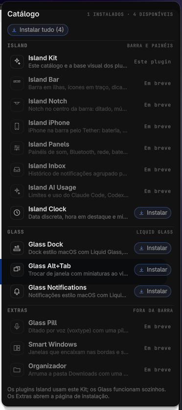

<div align="center">

# Island Kit

**One plugin, the whole family.**
A catalog in your bar that installs the Island and Glass plugins, and the shared
look the Island plugins are built on.



</div>

## Why this one

- 🧩 **Install once, pick the rest.** Add the Kit and every Island and Glass plugin
  is one click away in its catalog: install, enable or remove, or install them all.
- 🆕 **Always up to date.** The list comes from this repository, so new plugins
  show up in the catalog without updating the Kit. Offline, it shows the list it
  shipped with.
- 🎨 **The Island look.** The Island plugins (bar, notch, iPhone, panels…) are
  drawn with the components in `ui/`: thin stroke icons on a 24-unit grid, dark
  panels with hairline rims, one easing curve. Installing the Kit is what lets them
  load.
- 🌍 English and Portuguese, following your system language.

## Install

```bash
omarchy plugin add https://github.com/hugorolimf/omarchy-island-kit --enable
```

Click the puzzle icon in the bar, or run
`omarchy-shell io.github.hugorolimf.kit toggle`.

## What's in the catalog

| Island (uses this Kit) | Glass (works on its own) | Extras (outside the bar) |
|---|---|---|
| Island Bar · Island Notch · Island iPhone · Island Panels · Island Inbox · Island AI Usage · Island Clock | [Glass Dock](https://github.com/hugorolimf/omarchy-dock) · [Glass Alt+Tab](https://github.com/hugorolimf/omarchy-alttab) · [Glass Notifications](https://github.com/hugorolimf/omarchy-notifications) | Glass Pill · Smart Windows · Organizador |

Plugins not released yet show as *Soon*. Extras are not shell plugins; their row
opens their install page.

## How it installs

Each button runs Omarchy's own `omarchy plugin add <repo> --enable --yes`
(or `omarchy plugin enable` / `omarchy plugin remove <id> --yes`), one at a time,
so everything goes through Omarchy's validation. Some plugins only appear after
the shell restarts; the catalog offers a **Restart** button when that's needed.

## For plugin authors

Island plugins import the components with a path import:

```qml
import "../io.github.hugorolimf.kit/ui"
```

`ui/` keeps the API of Omarchy's `qs.Ui` (same properties, signals and functions),
so a panel written for Omarchy moves over by changing that import. The design
tokens and stroke icons are in `ui/Anatomy.qml`; see `ui/UI.md`.

## Requirements

- Omarchy with the Quattro shell (Quickshell).
- `curl` (to fetch the latest catalog) and the JetBrainsMono Nerd Font Omarchy ships.

It writes no files of its own.

## Remove

```bash
omarchy plugin remove io.github.hugorolimf.kit
```

Island plugins need the Kit to load, so remove them first (from the catalog or with
`omarchy plugin remove`). Glass plugins keep working.

## Credits

`ui/` started as a copy of Omarchy's `qs.Ui` components by David Heinemeier Hansson
and the [Omarchy](https://github.com/basecamp/omarchy) contributors (MIT); the
anatomy look and icons are this Kit's.

## License

[MIT](LICENSE)
